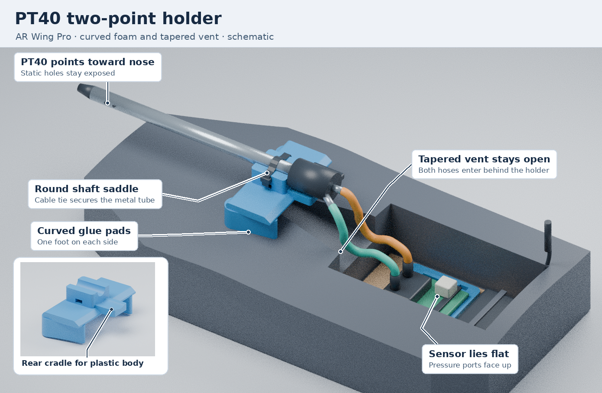

# AR Wing Pro PT40 mount

A two-piece glue-on mount for the Holybro PT40 pitot tube and MS5525DSO airspeed sensor on the SonicModell AR Wing Pro.

- [Round pipe holder STL](pitot-vent-bridge.stl) has a 4.8 mm open groove for the measured 4.5 mm PT40 shaft. Two glue pads are curved across and along the wing and straddle the existing vent. A 2.5 mm cable tie wraps over the tube. An integral rear cradle supports the black plastic manifold.
- [Sensor cradle STL](sensor-cradle.stl) holds the sensor flat on the plywood ahead of the ELRS receiver, with both pressure ports facing up.
- [OpenSCAD source](pt40-mount.scad) contains the part dimensions.



## Fit and assembly

Dry-fit the holder over the nose-side portion of the vent. The bridge spans 22 mm between its feet and passes over the tapered vent. Both glue pads sit on solid foam beside the recess. The starting profiles assume a 1.2 mm rise across the full 36 mm footprint and a 0.35 mm rise front to back over 18 mm. These are estimates. Use a straightedge across and along the mounting spot to check the profiles, and adjust the two crown settings and vent span in OpenSCAD if either pad rocks or overlaps the lip. Use foam-safe adhesive on the pads.

Seat the shaft immediately ahead of the black manifold, with the probe pointing straight toward the nose. Thread a narrow cable tie through the crosswise slot and snug it around the shaft. The rear cradle is sized for an estimated 9.5 mm manifold and includes about 0.2 mm of radial fit clearance. Check that the body sits in the cradle without contacting its factory tab or either hose barb. If there is a small gap, use a thin compliant shim under the body. Check that the tube cannot slide and that the static holes are exposed.

Feed a thin strap through the sensor cradle before gluing it to the plywood. With the board lying flat and its barbs up, route the two hoses through the rear of the vent behind the holder. Check for hose pinching with the hatch shut and ground clearance with the wing tilted nose-down.

## Export

```sh
openscad -o pitot-vent-bridge.stl -D 'part="saddle"' pt40-mount.scad
openscad -o sensor-cradle.stl -D 'part="cradle"' pt40-mount.scad
```
