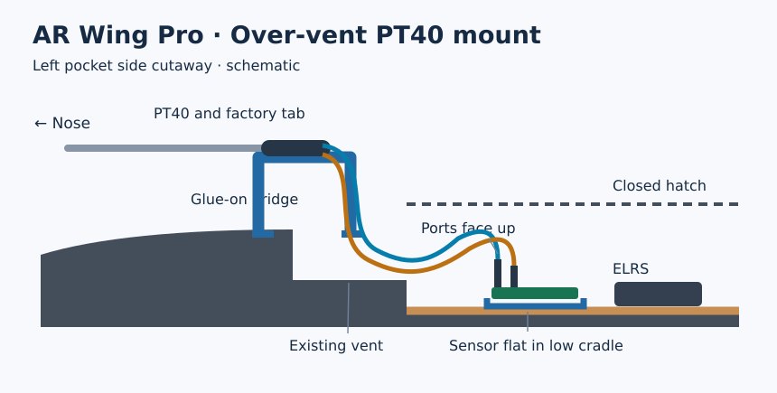

# AR Wing Pro PT40 mount

A two-piece, glue-on mount for a Holybro PT40 pitot tube and MS5525DSO airspeed sensor on the SonicModell AR Wing Pro.

- [Vent bridge STL](pitot-vent-bridge.stl) spans the existing left-pocket vent. Its two glue pads sit on the fixed foam and its upper recess seats the PT40 factory tab.
- [Sensor cradle STL](sensor-cradle.stl) sits on the plywood just inside the vent, ahead of the ELRS receiver. Feed a retaining strap through the cradle before gluing.
- [OpenSCAD source](pt40-mount.scad) contains the dimensions for both parts.



## Fit and assembly

The bridge has a 22 mm span and 10 mm clearance underneath. The span and tab dimensions are prototype estimates based on photos. Dry-fit both pads to the curved foam and check the tab fit before gluing.

Point the probe toward the nose with its pressure openings in open air. Lay the sensor flat with the ports facing up and orient the port end toward the vent. Feed a thin strap through the rear slots before gluing and keep it clear of the ports, connector, and exposed components. Route each hose up off its port, then in a gentle bend toward the existing vent and under the bridge. The 1.8 mm cradle floor leaves roughly 7 mm above the bare ports given a 20 mm pocket depth and an 11.4 mm sensor height. Actual hose clearance depends on the hatch shape. Check that both hoses bend freely with the hatch shut and that the probe clears the ground with the wing tilted nose-down. Use foam-safe adhesive on the bridge pads.

## Export

```sh
openscad -o pitot-vent-bridge.stl -D 'part="saddle"' pt40-mount.scad
openscad -o sensor-cradle.stl -D 'part="cradle"' pt40-mount.scad
```
